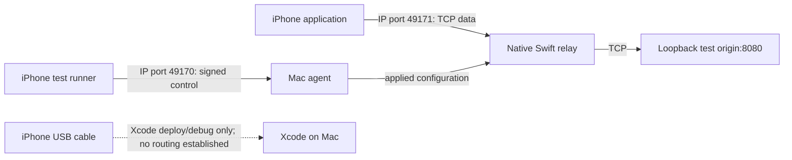

# ConnectionRig

A native Swift test SDK, scoped TCP relay, and macOS companion for changing **test traffic** during XCTest or Swift Testing runs. macOS 14+, iOS 17+, Swift 6, Xcode 16+.

**Status: implementation preview.** Eight unit tests and three real-TCP host integration tests pass. Xcode builds both the hosted unit-test and UI-test bundles. The user has reported the hosted iPhone flow working; the new UI scenario has not yet been run on a device, and full physical acceptance remains open. USB-only routing is unresolved. See [validation](docs/VALIDATION.md) before relying on it. No Toxiproxy dependency, private Apple APIs, system-wide network rules, or radio controls.

## Run locally

```sh
swift build
python3 scripts/fixture-server.py
```

In another terminal, run either the companion **or** the headless agent:

```sh
# Development bundle; this command does not launch it.
sh scripts/package-companion.sh
# Open dist/ConnectionRig.app yourself, configure upstream 127.0.0.1:8080,
# set Listen IP to your Mac's test-LAN address, then Start agent.

# Headless alternative; replace 192.168.1.20 with your Mac's address.
swift run rig-agent --bind 192.168.1.20 \
  --upstream-host 127.0.0.1 --upstream-port 8080 \
  --pairing-file /tmp/connectionrig.pairing
```

Default binding is loopback. LAN access requires the explicit `--bind` choice (or Setup field). Control port is 49170; controlled traffic is 49171. The fixture stays on loopback port 8080. Copy the secret from Setup or the mode-0600 pairing file through a trusted channel. Never commit it. CLI deletes its pairing file on graceful shutdown and refuses to overwrite one left by a crash.

## Add to tests

In Xcode, add this local package and link the **ConnectionRig** product to the test target. No remote repository or release has been published. Configure the app's download endpoint independently; adding the package does not reroute app traffic. Add local network privacy and ATS declarations to the test host; see [iPhone setup](docs/DEVICE-SETUP.md).

```swift
import ConnectionRig

let rig = try await TestRig.connect(configuration: .init(
    endpoint: URL(string: "http://192.168.1.20:49170")!,
    pairingSecret: secretFromTestEnvironment
))
let session = try await rig.beginSession(clientName: "Download recovery")
do {
    try await session.setNetwork(.init(
        downloadKBps: 1_000, uploadKBps: 200, chunkDelayMilliseconds: 5
    ))
    // Your app helper starts a GET to http://192.168.1.20:49171/file,
    // then signals actual transfer progress.
    try await download.startAndWaitForHalfway()
    try await session.setNetwork(.init(downloadKBps: 100, uploadKBps: 50))
    try await session.interrupt(for: .seconds(3))
    try await download.verifyRecoveredFile()
    try await session.close()
} catch {
    try? await session.close()
    throw error
}
```

The `download` helper above belongs to your application. Runnable examples for **both XCTest and Swift Testing** are in [DeviceTests.swift](Examples/DownloadLab/Tests/DeviceTests.swift), with explicit endpoint injection, progress synchronization, restart recovery, and SHA-256 verification. SDK internals import neither test framework.

## Unit tests and UI tests

The same `ConnectionRig` product works from both test targets:

| Test type | Executes app actions | Controls the connection |
| --- | --- | --- |
| Hosted XCTest or Swift Testing | Your test calls the model/service directly | `TestRig` and `RigSession` |
| XCTest UI testing | `XCUIApplication`, button taps, and UI state queries | The same `TestRig` and `RigSession` in the UI-test runner |

The **DownloadLab** scheme has hosted model tests that start their transfer in code. Its visible Download button is a manual demo and is not used by those tests. The **DownloadLabUITests** scheme has a [UI scenario](Examples/DownloadLab/UITests/DownloadFlowUITests.swift) that launches the app, taps Download automatically, waits for measured progress, slows the existing connection, observes more progress, interrupts it, then asserts recovery in the UI. Configure the three environment variables separately for that scheme; no pairing secret is copied into it. Initial OS consent and device setup still apply. See [device setup](docs/DEVICE-SETUP.md).

For a cart test, your UI test can navigate to a product and tap Add to cart, while its SDK calls control routed cart traffic. Use a real request-start or progress signal to select the injection point. ConnectionRig does not infer those app-specific events. UI automation uses XCTest/XCUIAutomation; Swift Testing remains supported for non-UI tests, following [Apple's testing guidance](https://developer.apple.com/documentation/xcode/testing).

## Exactly what changes



Bandwidth is decimal KB/s, **per TCP connection and direction**, including protocol headers/TLS records; nil means unpaced. Existing and new relay connections consult the current configuration. Small buffers and scheduling cause short transients; this is not an exact link-speed emulator. Chunk delay adds delivery delay to each received relay chunk in both directions; it is **not an RTT promise**.

Interruption closes real relay TCP sockets and accepts-then-closes new sockets until the deadline. It does not cancel a URLSession task inside the app, generate artificial HTTP errors, disconnect Wi-Fi, change the radio, or affect traffic bypassing the relay. Restoration returns to unpaced forwarding, including after a timed interruption. The app must implement recovery; a broken TCP stream cannot resume itself.

## Safety and limits

One active session. The agent owns a 15-second renewable lease and monotonic restoration timers. Heartbeats default to 3 seconds. SDK death allows lease expiry; agent death closes relay sockets and leaves no persistent network restrictions. The routed service stays unavailable until the agent restarts. See [security](docs/SECURITY.md).

Only an explicitly routed TCP endpoint is controlled. HTTP/1.1 foreground downloads are the example acceptance path. The relay is not an HTTP CONNECT proxy, VPN, transparent interceptor, USB tunnel, or packet filter. TLS bytes can pass through unchanged, but correct URL hostname, certificate validation, DNS routing, and pinning remain the application's responsibility. HTTPS, HTTP/2, and background URLSession paths are unverified. QUIC/HTTP/3 and UDP bypass this engine and are unsupported. See [evidence and limitations](docs/FEASIBILITY.md).

## Validate and contribute

```sh
sh scripts/check.sh             # All host tests, including real loopback TCP
sh scripts/check.sh unit        # Explicitly excludes the three socket integration tests
sh scripts/build-ios-source.sh  # iOS SDK + unsigned app compilation + test-source typecheck
```

[Architecture](docs/ARCHITECTURE.md) · [Physical iPhone acceptance](docs/DEVICE-SETUP.md) · [Validation and milestones](docs/VALIDATION.md) · [Troubleshooting / CI](docs/TROUBLESHOOTING.md) · [Contributing](CONTRIBUTING.md) · [BLE next milestone](docs/BLE-ROADMAP.md)

MIT licensed; see [LICENSE](LICENSE) and [third-party notices](THIRD-PARTY-NOTICES.md). No releases or binaries have been uploaded.
