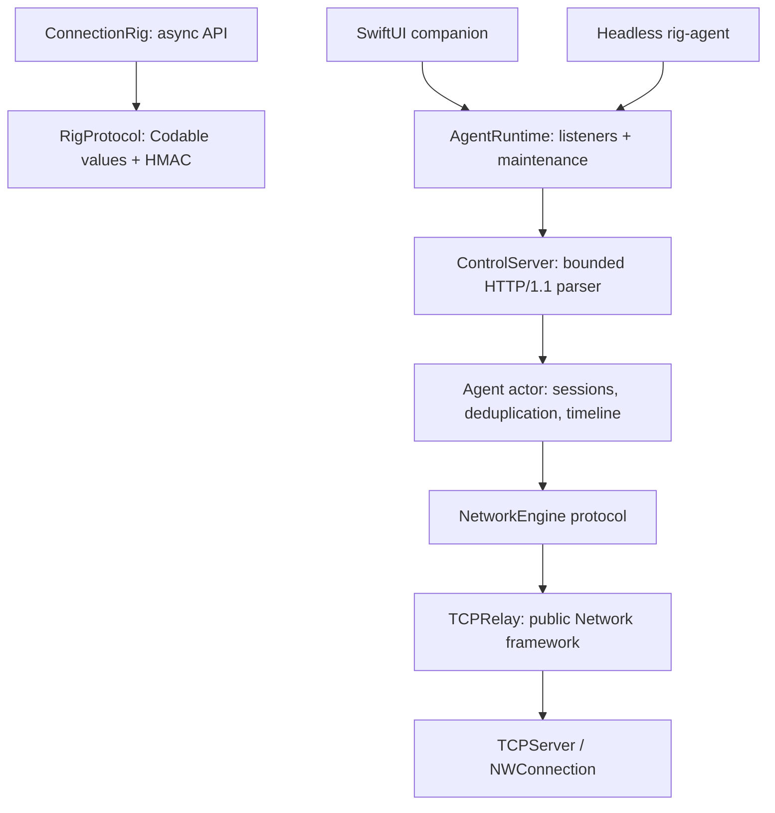

# Architecture and protocol

The executable products share the agent services. They are alternatives, not two processes that need to run together. The app's menu bar presence keeps the service available when its window closes. The headless executable provides the same engine without SwiftUI and is the CI entry point. No app-owned singleton or shared networking engine exists.

`Agent` owns in-memory session state, timers, command acknowledgements, and reports; `TCPRelay` owns traffic; `ControlServer` owns HTTP framing; the SDK owns a separate URLSession transport; UI rendering polls snapshots. Internal control-transport injection allows deterministic SDK failure tests without conflating them with real socket tests. The NetworkEngine boundary is limited to implemented network operations. No generic scenario graph or speculative BLE executor is present.

## Command contract

POST `/v1/command`, HTTP/1.1, Content-Length, JSON body, `X-Rig-Signature`. Protocol version 1. Request MAC is HMAC-SHA256 over UTF-8 `request-v1` immediately followed by exact body bytes. Response MAC uses the distinct `reply-v1` prefix. JSON dates use Foundation's default seconds since 2001-01-01. SDK command encoding sorts keys. The body includes UUID command ID, issued-at date, operation, and operation-specific fields; unknown enum values fail decoding. Schema checks reject incompatible operation fields, unsupported versions, invalid limits and durations. Unknown extra JSON keys are ignored by Codable; future behavior requires a new version/capability.

Operations: discover, begin, set, interrupt, restore, heartbeat, close, inspect. Discover returns the engine's actual capabilities. `packetLoss`, `radioControl`, `usb`, and `ble` are explicitly unavailable. Required unsupported capability is rejected without executing the operation.

A command ID identifies exact bytes. Duplicate bytes return the original reply; changed bytes with the same ID conflict. Replies are historical acknowledgements, not a fresh read of state: inspect for current state after a retry. IDs are cached through the signed command's 60-second validity window. Expired commands cannot execute after cache eviction. At 256 cached entries the agent rejects new commands until entries age out, rather than evict valid replay protection. Clock skew beyond 60 seconds is an error. New secrets after restart prevent replay across process lifetimes.

The actor rejects concurrent operations as busy while engine application awaits. SDK retries busy once after 100 ms and network errors once with identical serialized bytes. There is no ordering guarantee for deliberately concurrent SDK calls; sequence related operations with await. Cancellation stops URLSession work and retries; an already delivered command may still apply. Inspect state or restore using a new uncancelled task; never infer remote rollback from local cancellation.

Successful set acknowledgements follow the relay's installation of the configuration; an interrupt acknowledgement follows cancellation of active accepted sockets and their upstreams plus installation of the block flag. Bytes already in OS/network buffers cannot be recalled. An applied event means the relay configuration is installed, not that a physical phone measured an exact speed.

## Restoration and memory

A 50 ms runtime tick checks monotonic deadlines. Scheduling may be later under load; requested interruption is a minimum target, not a real-time guarantee. All session mutations/heartbeats renew a 15-second lease. Inspect and cached retries do not renew it. Heartbeat failure is exposed on the SDK session and stops that heartbeat loop; lease expiration restores forwarding. Interruption restoration clears earlier limits too, returning to normal unpaced forwarding. Set while blocked is explicitly rejected; restore ends a block immediately. Close is idempotent for retained completed sessions, and SDK close is locally idempotent.

Shutdown closes listeners and all sockets. Agent state and conditions live only in memory; crash recovery requires no rollback of OS settings. Restart creates an unpaced relay and new pairing. A crashed intermediary cannot continue forwarding, so app recovery needs a live restarted agent. This tradeoff is explicit.

Limits: 64 concurrent sockets per listener, control headers <=8 KiB, command bodies <=64 KiB, 10-second incomplete control-request lifetime, 200 timeline events per session and 10 completed reports, bounded replay cache. No disk session store; export reports before exit. Heartbeat events are not added to timelines. TCP backpressure bounds each direction's application buffer to a 16 KiB read chunk; each pacing write is at most 20 ms worth at a limited rate. Pending pacing writes observe rate changes at the next slice; chunk-delay waits recheck the current value every 10 ms. Multiple connections multiply the available aggregate throughput.

## Test runners and application actions

ConnectionRig has no dependency on XCTest, Swift Testing or XCUIAutomation. Hosted unit/integration tests call their models or services directly; an XCTest UI-test runner controls the visible application using XCUIApplication. Both call the same SDK over the separate authenticated control listener. The UI runner injects the controlled data endpoint into the app on launch. Only the app's data traffic traverses the relay.

The DownloadLabUITests example uses stable accessibility identifiers and numeric progress values to determine when to change bandwidth and interrupt the stream. Those identifiers belong to the example application/test helpers; the SDK does not contain UI queries, perform taps or infer cart/download events. The hosted DownloadLab examples remain separate and use XCTest or Swift Testing assertions respectively. Separate schemes avoid overlapping sessions in this single-session MVP.
